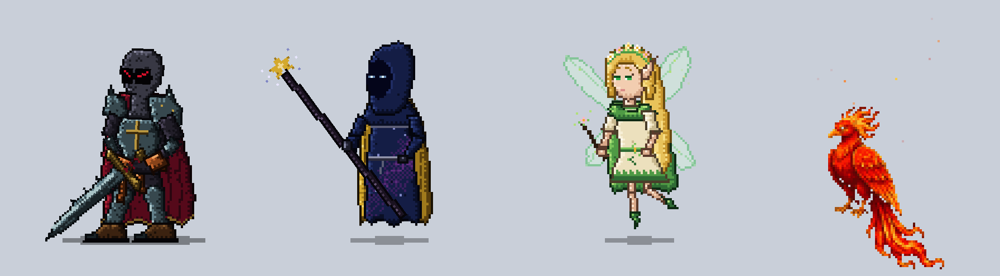

# Glitch

**A desktop companion for macOS that keeps watch over your Claude Code and Codex sessions.**

Glitch is a native SwiftUI desktop pet app for macOS. A pixel companion lives quietly at the bottom of your screen. When one of your Claude Code or Codex sessions needs you, it tells you with a move, not with a popup. Free and open source.

<p align="center"></p>

## Pick your companion

| | Who | Permission waiting | Question | Finished | Error |
|---|---|---|---|---|---|
| ⚔️ | **Vorn**, a cursed pixel ghost-knight | keeps vigil, sword upright | turns to look at you | flicks his sword | lets the sword slip and catches it |
| ✨ | **Wizzy**, a cosmic mage | a red rune hangs in the air | gazes into a crystal ball | a feast of falling stars | the spell sputters |
| 🌸 | **Faelis**, a fairy elf queen | a flower bud | a calling wave | the bud blooms | the flower wilts |
| 🔥 | **Phoenix**, a crimson firebird | a wall of fire round its feet | a beacon of flame from its crest | a golden feather drifts down | its flames go out in smoke |

Each one has its own arrival, goodbye, click and idle moves, its own sounds and its own menu bar icon. Switch any time in the Customize window.

The pictures below show Vorn.

<p align="center">
  
  
  
</p>

## The sentinel

If you run several Claude Code or Codex sessions at once, it's easy to miss the one waiting for you. Glitch watches **every** Claude Code session on your Mac, in the desktop app and in the terminal, in any project, and Codex sessions too:

| A session… | Vorn… | Spark |
|---|---|---|
| needs your **permission** | keeps vigil, sword upright | crimson |
| **asked you a question** | turns to look at you | crimson |
| **finished** its turn | flicks his sword and scrapes it along the ground | gold |
| **crashed** (API error) | lets the sword slip and catches it | — |

- **One spark per session.** Crimson means "waiting for you", gold means "done, come and look".
- **Hover** over your companion to see the list (project · session · state · how long).
- **Click** to open the most urgent session. Desktop sessions open directly; terminal sessions bring your terminal forward.
- **Calm by design.** Your companion only reacts when something actually happens. If a permission request goes unanswered for 5 minutes it reminds you once, then waits again.
- **Choose which projects count** under *Watched projects* in the menu.
- **Codex** has no question or crash events, so with Codex you get the permission and finished reactions.

<p align="center"></p>

### How it works

Glitch adds a tiny hook script to Claude Code's global settings (`~/.claude/settings.json`). Claude Code calls it on events such as `PermissionRequest`, `Stop` and `StopFailure`. For Codex the same script goes into `~/.codex/hooks.json`; Codex asks you to trust it once under `/hooks`. The script drops each event as a file into `~/Library/Application Support/Glitch/events/` and exits right away. Glitch reads those files and reacts.

- **Nothing leaves your Mac.** No network, no account.
- **Your settings are safe.** Installing shows exactly what will be added and asks first. Your existing hooks are kept, a backup is written, and *Remove* takes out only Glitch's entries.
- **Claude Code and Codex are never slowed down.** The hook always exits immediately, even when Glitch isn't running.

## Also

- Breathes, blinks, wanders (the phoenix flies), changes stance, and greets you when your Mac wakes.
- Drag it around; it reacts and settles back down.
- Steps out of the way of the text box you're typing in (needs the Accessibility permission).
- Hides when a fullscreen app is in front.
- Sounds are synthesized in code (the phoenix uses free recordings), and each group can be turned off.

<p align="center"></p>

**Customize:** color theme, size, liveliness (calm / normal / lively), gravity, hide in fullscreen.
**Sound:** volume, mute, per-event sound groups.

## Install

1. Download `Glitch.zip` from [Releases](../../releases) and move `Glitch.app` to `/Applications`.
2. The app isn't notarized by Apple, so the first time **right-click → Open**, then **Open** again. If macOS still refuses, run `xattr -dr com.apple.quarantine /Applications/Glitch.app` once.

Or build it yourself (below).

## Requirements

- macOS 15 or later
- [Claude Code](https://code.claude.com) or [Codex](https://developers.openai.com/codex) for the sentinel. The rest of Glitch works without it.

## Build

```bash
brew install xcodegen
xcodegen
xcodebuild -scheme Glitch -configuration Release -destination 'platform=macOS' build
```

The project signs with an Apple Development identity so the Accessibility permission survives rebuilds. To build with your own identity, change `DEVELOPMENT_TEAM` in `project.yml`, or set `CODE_SIGN_IDENTITY: "-"` to sign ad-hoc.

Run the tests:

```bash
xcodebuild -scheme Glitch -destination 'platform=macOS' test
```

## First run

1. Open Glitch and pick a companion on the welcome screen.
2. Menu bar icon → **Claude Code sentinel: Install…** and/or **Codex sentinel: Install…** to install the sentinel hook. For Codex, then run `/hooks` in Codex and trust Glitch's hook.
3. Optional: grant **Accessibility** (System Settings → Privacy & Security) so it can step out of the way of text boxes.

## License

MIT. See [LICENSE](LICENSE).

The phoenix's sounds in `Glitch/Sounds` are trimmed from free recordings:
- CC0: "CC0 deep monster roar" by trazzz123, "Dragon Flap" by VishwaJai, "Fire Staff" by LEGIT Audio and "Fire Crackling" by AntumDeluge, all on [OpenGameArt](https://opengameart.org).
- [CC BY 3.0](https://creativecommons.org/licenses/by/3.0/): "[Screaming Hawk](https://commons.wikimedia.org/wiki/File:Screaming_Hawk.wav)" by PsychoBird, on Wikimedia Commons (trimmed).
