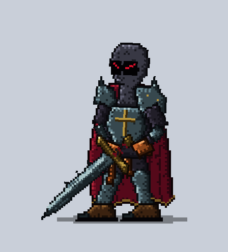
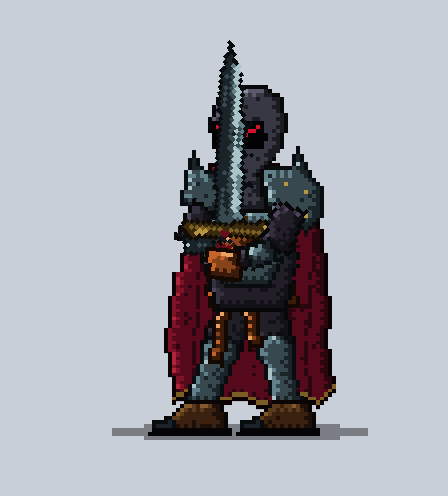
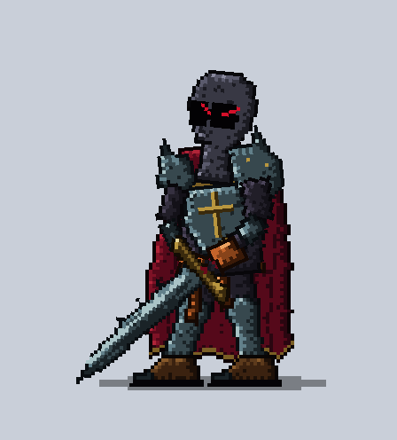
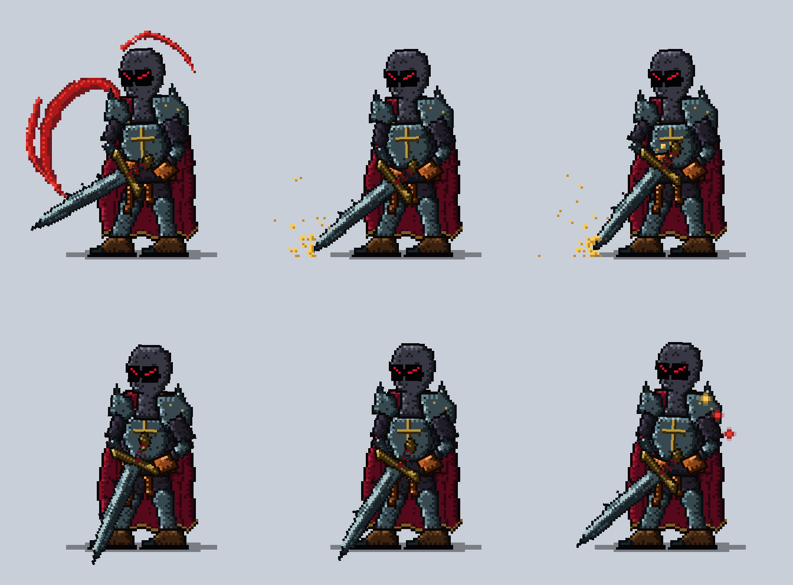
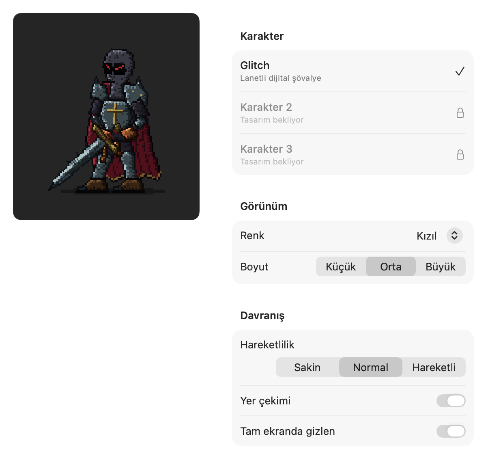

# Glitch

**A pixel ghost-knight that lives on your Mac desktop and keeps watch over your Claude Code sessions.**

Glitch is a native SwiftUI desktop pet for macOS. He stands guard quietly at the bottom of your screen. When one of your Claude Code sessions needs you, he shows it with his sword, not with a popup.

<p align="center">
  
  
  
</p>

## The sentinel

If you run several Claude Code sessions at once, it's easy to miss the one waiting for you. Glitch watches **every** Claude Code session on your Mac, in the desktop app and in the terminal, in any project:

| A session… | Glitch… | Spark |
|---|---|---|
| needs your **permission** | keeps vigil, sword upright | crimson |
| **asked you a question** | turns to look at you | crimson |
| **finished** its turn | flicks his sword and scrapes it along the ground | gold |
| **crashed** (API error) | lets the sword slip and catches it | — |

- **One spark per session.** Crimson means "waiting for you", gold means "done, come and look".
- **Hover** over Glitch to see the list (project · session · state · how long).
- **Click** to open the most urgent session. Desktop sessions open directly; terminal sessions bring your terminal forward.
- **Calm by design.** He only reacts when something actually happens. If a permission request goes unanswered for 5 minutes he reminds you once, then waits again.
- **Choose which projects count** under *Watched projects* in the menu.

<p align="center"></p>

### How it works

Glitch adds a tiny hook script to Claude Code's global settings (`~/.claude/settings.json`). Claude Code calls it on events such as `PermissionRequest`, `Stop` and `StopFailure`. The script drops each event as a file into `~/Library/Application Support/Glitch/events/` and exits right away. Glitch reads those files and reacts.

- **Nothing leaves your Mac.** No network, no account.
- **Your settings are safe.** Installing shows exactly what will be added and asks first. Your existing hooks are kept, a backup is written, and *Remove* takes out only Glitch's entries.
- **Claude Code is never slowed down.** The hook always exits immediately, even when Glitch isn't running.

## Also

- Breathes, blinks, wanders, changes stance, and greets you when your Mac wakes.
- Drag him around; he reacts and falls back to the ground.
- Steps out of the way of the text box you're typing in (needs the Accessibility permission).
- Hides when a fullscreen app is in front.
- Sounds are synthesized in code, and each group can be turned off.

<p align="center"></p>

**Customize:** color theme, size, liveliness (calm / normal / lively), gravity, hide in fullscreen.
**Sound:** volume, mute, per-event sound groups.

## Requirements

- macOS 15 or later
- [Claude Code](https://code.claude.com) for the sentinel. The rest of Glitch works without it.

## Build

```bash
brew install xcodegen
xcodegen
xcodebuild -scheme Glitch -configuration Release -destination 'platform=macOS' build
```

The project signs with an Apple Development identity so the Accessibility permission survives rebuilds. To build with your own identity, change `DEVELOPMENT_TEAM` in `project.yml`, or set `CODE_SIGN_IDENTITY: "-"` to sign ad-hoc.

Run the tests:

```bash
xcodebuild -scheme Glitch -destination 'platform=macOS' test
```

## First run

1. Open Glitch. He drops in from the top of the screen.
2. Menu bar icon → **Claude Code sentinel: Install…** to install the sentinel hook.
3. Optional: grant **Accessibility** (System Settings → Privacy & Security) so he can step out of the way of text boxes.

## License

MIT, see [LICENSE](LICENSE).
